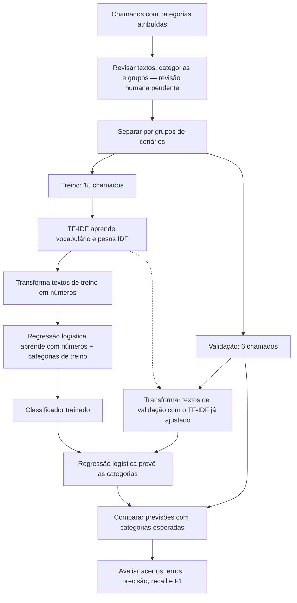

# Fluxograma do classificador de chamados

Este documento mostra o processo do primeiro experimento didático: 18 chamados
para treino e 6 para validação. A revisão humana dos dados ainda está pendente,
e o conjunto de teste final ainda não foi preparado.

Os diagramas usam Mermaid e podem ser visualizados no GitHub.

## Treinamento e validação

A revisão aparece antes da divisão como ordem de trabalho pretendida. O primeiro
treino já foi executado de forma provisória, antes de concluir essa revisão.
Chamados do mesmo grupo permanecem juntos para evitar que versões muito
parecidas de um cenário apareçam tanto no treino quanto na validação.
Os rótulos da validação servem para conferir as previsões, não para ensinar o modelo.

## Papel de cada técnica

| Técnica | Função |
|---|---|
| TF-IDF | Transforma textos em números, considerando a frequência das palavras no chamado e sua frequência no conjunto de treino. |
| Regressão logística | Aprende associações entre esses números e as categorias. Apesar do nome, é usada aqui para classificação. |

O TF-IDF aprende o vocabulário e os pesos IDF somente no treino. Na validação,
aplica a transformação já aprendida. Na configuração atual, palavras ausentes
do vocabulário de treino são ignoradas.

A palavra “senha” não garante a categoria `acesso`: o classificador combina
os pesos das palavras presentes. Essa análise é estatística e pode não captar
bem o contexto ou a intenção da mensagem.

## Classificar um novo chamado

Prever não é treinar novamente: o modelo aplica o que já aprendeu. A previsão
pode estar errada, por isso avaliamos o desempenho com exemplos separados.
O treinamento salva a pipeline em `models/classificador.joblib`.
O script `scripts/classificar.py` carrega esse arquivo para prever a categoria
de um chamado digitado, sem ajustar novamente o modelo.
